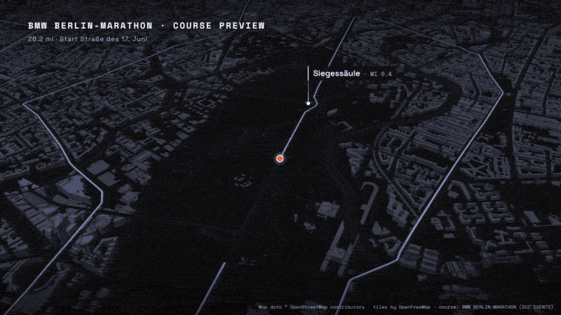

# Berlin Marathon course tour

A scripted 3D fly-through of the BMW BERLIN-MARATHON course: a helicopter-style camera
orbits an orange dot from the start on Straße des 17. Juni to the finish beyond the
Brandenburg Gate, rendered frame by frame to 16:9 and 9:16 MP4.



The GIF is the 60 second render sped up to about 10 seconds. Built with MapLibre GL JS,
OpenFreeMap vector tiles and headless Chromium (Playwright), encoded with ffmpeg.

## What you get

- one continuous run of the course: the dot waits on the start line under the title, eases
  up to a constant speed, eases down and holds on the finish line with the Gate in frame
- a camera that orbits at constant altitude and turns at one constant rate, so corners
  move the dot across the frame instead of swinging the whole city
- 3D buildings extruded from OpenStreetMap heights, the route drawn as it is covered,
  markers every 5 miles, a mile counter and progress bar
- twelve landmark pins (Siegessäule, Alexanderplatz, Kurfürstendamm, Potsdamer Platz,
  Brandenburger Tor and others), each checked against the course geometry
- deterministic output: every frame is a pure function of time, so frame 900 is the same
  whether it is rendered first or last

## Quick start

Prerequisites: Python 3.9+, [ffmpeg](https://ffmpeg.org/) on your `PATH`, an internet
connection (map tiles stream from OpenFreeMap; the course GPX downloads from the organiser).

```bash
git clone <this repo> berlin-marathon-course-tour
cd berlin-marathon-course-tour

python3 -m venv .venv
. .venv/bin/activate
pip install -r requirements.txt
playwright install chromium

# download the organiser's GPX and build course/course.js (both git-ignored)
python course/build-course.py

# camera check: probes every frame, geometry only, takes seconds
python render.py --check

# a 3 second test render
python render.py --duration 3 --out renders/test.mp4

# the full 60 second tour, 16:9 (1920x1080) and 9:16 (1080x1920)
python render.py --out renders/course-tour-16x9.mp4
python render.py --portrait --out renders/course-tour-9x16.mp4
```

A full render is 1,800 frames. Chromium rasterises WebGL in software (SwiftShader), and each
frame waits for every tile to load, so it takes a while: on the machine this was tested on,
60 frames took 33 s after a 15 s tile prefetch, so a full cut is roughly 17 minutes plus
encoding. CPU and network speed move that number.

To watch it live in a browser: `python -m http.server 8765`, open
`http://127.0.0.1:8765/preview.html` (add `?portrait=1` for 9:16). Space plays and pauses,
the arrow keys scrub 5 seconds.

### render.py options

| flag | what it does |
| --- | --- |
| `--check` | probe every frame's camera (no tiles), print smoothness numbers, write nothing |
| `--portrait` | 1080x1920 stage; layout adapts, camera pulls back by `portraitZoomDelta` |
| `--start S`, `--duration S` | render a window instead of the whole 60 s |
| `--still T` | one PNG at time T (`--out something.png`) |
| `--clean` | plate for compositing: no title, mile counter, progress bar or attribution line |
| `--out PATH` | output file (default `renders/course-tour.mp4`) |
| `--frames-dir DIR` | where the PNG frames go (default `./frames`, wiped each run) |
| `--frame-log CSV` | per-frame camera log (default `frames.csv` in the frames folder) |
| `--no-encode` | keep the PNGs, skip ffmpeg |
| `--no-prefetch` | skip the tile warm-up pass along the route |
| `--fps N` | override the timeline's 30 fps |

If you use `--clean`, whatever you composite on top must carry the map and course credit
(see "Credits and licences").

## How the camera works

The camera is a helicopter in a slow orbit: constant altitude, pitch and distance, always
looking at the dot. Three pieces make it smooth.

**The dot moves at a constant distance rate.** It sits on the start line for 0.8 s, its
speed ramps up over 2.5 s (smoothstep), runs flat at about 786 m/s of course, ramps down
over 2.5 s and arrives on the finish line at 57 s. The last 3 s hold on the finish.

**The camera looks at a smoothed copy of the dot.** The map centre is the dot's ground
position through a zero-phase Gaussian low-pass (sigma 0.7 s), tabulated at 120 Hz. Because
the filter is symmetric in time, corners are rounded off with no lag, and no parameter can
snap. In the closing seconds the aim point slides part of the way from the finish line
towards the Brandenburg Gate, before smoothing, so the Gate sits in the hold.

**The bearing turns at one constant rate.** From 245 to 445 degrees over the whole 60 s:
200 degrees clockwise, 0.111 degrees per frame. Zoom and pitch are constants. Nothing
follows the road's heading, which is what keeps a sharp corner from swinging the city.

**Every frame waits for the map to be idle.** `render.py` seeks to time t, then waits for
MapLibre's `idle` event (all tiles and buildings loaded) before it screenshots the stage. It
reports how many waits timed out and how many frames were painted with tiles still loading
(both should be 0), writes a per-frame camera log, and prints the smoothness numbers: centre
movement and acceleration per frame, bearing rate, dot position on screen, pin overlaps.

`render.py --check` runs the same numbers on geometry alone, without waiting for tiles. Its
pin overlap count is measured before fonts and tiles settle, so it can read 0 where a real
render finds overlaps: trust the `overlaps` column of a real render's frame log.

## The knobs (timeline-preview.js)

Everything about the shot is in `timeline-preview.js`:

| knob | default | meaning |
| --- | --- | --- |
| `duration`, `fps` | 60, 30 | length and frame rate |
| `dot.startAt` | 0.8 | seconds on the start line before the dot moves |
| `dot.easeIn`, `dot.easeOut` | 2.5, 2.5 | speed ramp at each end, seconds |
| `dot.arriveAt` | 57.0 | when the dot reaches the finish; the rest is the hold |
| `camera.zoom`, `camera.pitch` | 14.75, 54 | the helicopter's distance and angle, constant |
| `camera.bearingStart`, `bearingEnd` | 245, 445 | the orbit; positive difference turns clockwise |
| `camera.smoothSigma` | 0.7 | Gaussian smoothing of the aim point, seconds |
| `camera.finishAim`, `finishAimShare` | Gate, 0.35 | where the aim drifts to in the hold, and how far |
| `camera.finishAimFrom`, `finishAimFull` | 53, 58 | when that drift ramps in |
| `camera.portraitZoomDelta` | -0.45 | pull back in 9:16 |
| `title`, `hud` | | fade timings `[in start, full, out start, gone]` |
| `pinLead`, `pinTrail` | 1700, 900 | metres before and after a pin's km that it shows |
| `pins` | | name, coordinates, course `km`, offset from the route `offM`, plus per-pin `side`, `stem`, `lead`, `trail`, `portraitTrail`, `gold`, `sub` |

The look (colours, fonts, safe areas for 9:16) is in the `<style>` block of `preview.html`.
Distances on screen are in miles; the conversion is in `preview.js`.

## Files

```
preview.html              stage, title, mile counter + progress bar, pin layer, attribution
preview.js                dot timing, orbit camera, pins, seek/probe for render.py
timeline-preview.js       every knob
render.py                 headless frame grabber + ffmpeg encode + smoothness report
course/build-course.py    downloads the organiser GPX, builds course/course.js (stdlib)
course/check-landmarks.py re-measures each pin against the course (stdlib)
course/SOURCE.md          where the course geometry comes from, and its terms
fonts/                    Space Grotesk, Space Mono (SIL OFL 1.1)
vendor/                   MapLibre GL JS 5.6.0 (BSD-3-Clause)
docs/                     the README GIF, a poster frame, and make-gif.sh that builds them
```

## Checking the pins

```bash
python course/check-landmarks.py
```

For each pin it prints the distance from the landmark to the nearest point of the route,
the course km and miles there, and every other pass of the route within 800 m (the course
comes back past some places). It exits non-zero if a pin's `km` or `offM` in
`timeline-preview.js` no longer matches the geometry.

Checked and left out: Fernsehturm (514 m from the route) and Rotes Rathaus (742 m). The
Reichstag is pinned only at the finish so it does not crowd the Hauptbahnhof pin at km 7.

## Adapting it to another race

1. Get the course as a GPX track (`<trkpt>` points, start to finish). Check its terms.
2. Build the course file from it, with the certified length:
   `python course/build-course.py --gpx path/to/course.gpx --length-m 42195`
3. Edit `timeline-preview.js`: new `pins` (look up coordinates, then run
   `check-landmarks.py` and copy its km and metres into each pin), a `bearingStart` that
   looks down the opening straight, and a `finishAim` for the hold.
4. Edit the title and the course credit in `preview.html`.
5. Run `python render.py --check`, then a short test render, then the full one.

The local metre frame and the check scripts take their reference latitude from the course
itself, so nothing else is tied to Berlin.

## Credits and licences

- **Code in this repository:** MIT, see [LICENSE](LICENSE).
- **Course geometry:** the official GPX published by the organiser, BMW BERLIN-MARATHON
  (SCC EVENTS). It carries no open licence, so it is **not included** here: `build-course.py`
  downloads it from the organiser's site and the result stays on your machine (git-ignored).
  The render credits it on screen: `Course: BMW BERLIN-MARATHON (SCC EVENTS)`. See
  [course/SOURCE.md](course/SOURCE.md). This project is not affiliated with or endorsed by
  the organiser.
- **Map data:** © OpenStreetMap contributors, available under the
  [Open Database Licence (ODbL)](https://www.openstreetmap.org/copyright).
- **Map tiles:** [OpenFreeMap](https://openfreemap.org/) (`tiles.openfreemap.org`, dark
  style), built on OpenMapTiles. No API key needed.
- **Landmark coordinates** in `timeline-preview.js` come from OpenStreetMap via
  [Nominatim](https://nominatim.org/), so they are OSM data under the ODbL as well.
- **MapLibre GL JS 5.6.0:** BSD-3-Clause, see
  [vendor/LICENSE-maplibre.txt](vendor/LICENSE-maplibre.txt).
- **Fonts:** Space Grotesk and Space Mono, SIL Open Font License 1.1, see
  [fonts/OFL.txt](fonts/OFL.txt).

The burned-in attribution line (bottom right in 16:9, bottom left in 9:16) reads
`Map data © OpenStreetMap contributors · tiles by OpenFreeMap · course: BMW BERLIN-MARATHON (SCC EVENTS)`
and stays on screen for the whole render. Keep it there, or carry the same credit in
whatever you composite on top of a `--clean` plate. When you publish a video, also link
https://www.openstreetmap.org/copyright in the description.
